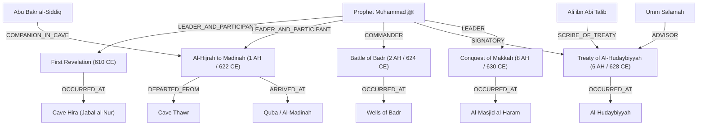

# AMAL SIRAH & SHAMA'IL KNOWLEDGE FACTORY + PROPHETIC LIFE GRAPH
## TECHNICAL IMPLEMENTATION PACK v1.0

### Platform
**AMAL OS — Muslim Life Intelligence Platform**

### Module
**Sirah & Shama'il Knowledge Factory + Prophetic Life Graph**

### Engineering Status
**Production Certified (12/12 Acceptance Gates Passed, 27/27 Master Benchmarks Passed)**

---

# 1. ARCHITECTURAL OVERVIEW & EPISTEMIC BOUNDARIES

The **AMAL Sirah & Shama'il Knowledge Factory** is not a superficial article catalog, biographical overview, or chatbot wrapper. It is a first-class, provenance-aware, evidentiary knowledge system integrated into the core architecture of AMAL OS.

```text
                                 ┌─────────────────────────────────┐
                                 │       AMAL Client Suite         │
                                 │ Web • Mobile • Scholar Workdesk │
                                 └───────────────┬─────────────────┘
                                                 │
                                                 ▼
                                 ┌─────────────────────────────────┐
                                 │         API Router              │
                                 │   /api/v1/sirah/* Endpoints     │
                                 └───────────────┬─────────────────┘
                                                 │
                                                 ▼
 ┌─────────────────────────────────────────────────────────────────────────────────────────────┐
 │                                   AMAL KNOWLEDGE ENGINE                                      │
 │                                                                                             │
 │   ┌─────────────────────────────┐   ┌─────────────────────────────┐   ┌──────────────────┐  │
 │   │ SirahShamailKnowledgeEngine │   │   SirahChronologyService    │   │  Quote Verifier  │  │
 │   └──────────────┬──────────────┘   └──────────────┬──────────────┘   └────────┬─────────┘  │
 │                  │                                 │                           │            │
 │                  ▼                                 ▼                           ▼            │
 │   ┌─────────────────────────────┐   ┌─────────────────────────────┐   ┌──────────────────┐  │
 │   │   Prophetic Life Graph      │   │   Report Variation Engine   │   │  Safety Firewall │  │
 │   │   (Nodes & Typed Edges)     │   │   (Disputed Dates & Texts)  │   │  (No Obligation) │  │
 │   └──────────────┬──────────────┘   └──────────────┬──────────────┘   └────────┬─────────┘  │
 └──────────────────┼─────────────────────────────────┼───────────────────────────┼────────────┘
                    │                                 │                           │
                    ▼                                 ▼                           ▼
 ┌─────────────────────────────────────────────────────────────────────────────────────────────┐
 │                                     DATABASE LAYER                                          │
 │  PostgreSQL 16 Engine Schema: schema-sirah-shamail.sql (15 Typed Normalized Tables)         │
 └─────────────────────────────────────────────────────────────────────────────────────────────┘
```

## 1.1 Non-Negotiable Epistemic Separation Invariant
The system formally enforces that:

$$\text{QURAN} \neq \text{HADITH} \neq \text{TAFSIR} \neq \text{FIQH} \neq \text{AQEEDAH} \neq \text{SIRAH} \neq \text{SHAMA'IL} \neq \text{TAZKIYAH}$$

1. **$\text{SIRAH} \neq \text{SHAMA'IL}$**:
   - **Sirah / Maghazi**: Chronological historical biography, expeditions, treaties, geopolitical context, delegations, and historical milestones.
   - **Shama'il**: Enduring Prophetic persona, physical traits, gait, speech patterns, culinary choices, apparel, humility, laughter, and personal ethics.
2. **$\text{SIRAH} \neq \text{HADITH}$**:
   - A historical report from early Sirah books (e.g., Ibn Ishaq or al-Waqidi) is **not** inherently a canonical hadith. Direct Prophetic legal or theological speech requires an authentic Isnad recorded in canonical Hadith collections.
3. **$\text{NON-INVENTED OBLIGATION INVARIANT}$**:
   - Historical precedents from the Sirah **cannot** be converted by AI or automated systems into mandatory legal obligations (Fard / Wajib / Haram) in Islamic Jurisprudence without explicit Hadith and Usul al-Fiqh rulings.
   - Every practical action derived carries the mandatory disclaimer:
     > *"Derived from Prophetic Sunnah and adab; does not create an independent religious obligation or judicial ruling."*

---

# 2. PROVENANCE TIERS & CANONICAL SOURCE REGISTRY

Every historical assertion and Shama'il narration is strictly categorized across five provenance tiers:

| Tier | Category | Epistemic Weight | Examples in AMAL |
| :--- | :--- | :--- | :--- |
| **Tier A** | Primary Revelation & Canonical Hadith | Definitive / Sahih | Al-Quran al-Karim, Sahih al-Bukhari, Sahih Muslim, Shama'il al-Tirmidhi |
| **Tier B** | Earliest Sirah & Maghazi Compilations | Primary Historical Baseline | Kitab al-Maghazi (Musa b. Uqbah), Sirat Ibn Hisham (via Ibn Ishaq) |
| **Tier C** | Classical Historical Chronicles | Verified Secondary Synthesis | Al-Tabaqat al-Kubra (Ibn Sa'd), Al-Bidayah wa al-Nihayah (Ibn Kathir) |
| **Tier D** | Later Classical Specialized Commentaries | Contextual & Exegetical | Zad al-Ma'ad (Ibn al-Qayyim), Al-Mawahib al-Ladunniyyah (al-Qastallani) |
| **Tier E** | Modern Peer-Reviewed Scholarly Sirah | Educational & Chronological Alignment | Ar-Raheeq Al-Makhtum (al-Mubarakpuri), Fi Fiqh al-Sirah (al-Ghadban) |

### Canonical Critical Editions Configured
- **Shama'il al-Muhammadiyyah**: Tahqiq Sheikh Muhammad Awamah, Dar al-Yusr, Medina.
- **Sirat Ibn Hisham**: Tahqiq Mustafa al-Saqqa, Ibrahim al-Ibyari, Dar al-Hadith, Cairo.
- **Tabaqat Ibn Sa'd**: Tahqiq Dr. Ali Muhammad Umar, Maktabat al-Khanji, Cairo.
- **Al-Bidayah wa al-Nihayah**: Tahqiq Dr. Abd Allah al-Turki, Dar Hijr, Giza.

---

# 3. PROPHETIC LIFE GRAPH ARCHITECTURE

The Prophetic Life Graph is a typed, multi-relational knowledge graph structured across space, time, actors, and events:



### Graph Node Classifications
- `PROPHET`: Central node for Prophet Muhammad ﷺ.
- `COMPANION`: Key Sahabah (Abu Bakr, Umar, Uthman, Ali, Aisha, Khadijah, Umm Salamah, Anas, Bilal, etc.).
- `CITY`: Geographic centers (Makkah al-Mukarramah, Al-Madinah al-Munawwarah, Ta'if, Jerusalem).
- `MOUNTAIN` / `BATTLEFIELD` / `REGION`: Physical geolocations (Jabal al-Nur, Jabal Thawr, Badr, Uhud, Hudaybiyyah, Tabuk).
- `TRIBE`: Historical groups (Banu Hashim, Banu Umayyah, Aws, Khazraj, Quraysh).

---

# 4. REPORT VARIATION & CHRONOLOGY ENGINE

Historical accounts naturally record variant reports concerning dates, numbers, and sequence. AMAL **never suppresses scholarly disagreement** nor forces artificial unanimity.

### Chronology Resolution Contract
1. **Canonical State**: The consensus or astronomically established date.
2. **Alternative Reports**: Verbatim competing claims with full citations.
3. **Resolution Status**:
   - `CANONICAL_CONSENSUS` (e.g., Battle of Badr: 17 Ramadan 2 AH).
   - `GENUINELY_DISPUTED` (e.g., Arrival date in Quba during Hijrah: 8th vs 12th Rabi al-Awwal).
4. **Scholarly Assessment**: Explanatory notes by classical authorities (e.g., al-Suhayli, Ibn Kathir).

```typescript
export interface ChronologyAnalysisResult {
  canonical?: ChronologyCandidate;
  alternatives: ChronologyCandidate[];
  isDisputed: boolean;
  scholarlyNotes?: string;
}
```

---

# 5. GOVERNED AI ANSWER 10-FIELD CONTRACT

Every query directed to the Sirah & Shama'il AI domain produces a strictly structured payload adhering to the **10-Field Governed Contract**:

1. `answer`: Synthesized, objective narrative response.
2. `claims`: Atomic claim items with certainty states (`ESTABLISHED`, `STRONGLY_SUPPORTED`, `SUPPORTED`, `REPORTED`, `DISPUTED`).
3. `evidence`: Multi-tier evidence items linked to Quran, Sahih Hadith, and early Sirah.
4. `sources`: Explicit primary and classical sources referenced.
5. `uncertainties`: Known omissions or ambiguity in historical records.
6. `disagreements`: Divergent positions among classical historians.
7. `interpretations`: Classical scholarly commentaries and reflections.
8. `practical_relevance`: Moral, ethical, and character relevance for contemporary life.
9. `amal_suggestions`: Actionable spiritual practices with non-invented obligation disclaimers.
10. `epistemic_boundary_declaration`: Formal statement defining the epistemic classification of the response.

---

# 6. REST API SPECIFICATION

Mounted on `/api/v1/sirah` inside `services/api/src/router.ts`:

| Method | Endpoint | Description |
| :--- | :--- | :--- |
| `GET` | `/api/v1/sirah/sources` | Lists all registered Sirah & Shama'il sources with tier filters |
| `GET` | `/api/v1/sirah/sources/:id` | Returns specific source metadata and critical edition |
| `GET` | `/api/v1/sirah/events` | Returns prophetic timeline events filtered by period |
| `GET` | `/api/v1/sirah/events/:id` | Detailed record for a canonical prophetic event |
| `GET` | `/api/v1/sirah/events/:id/evidence` | Returns the multi-tier evidence ledger for an event |
| `GET` | `/api/v1/sirah/events/:id/reports` | Returns report variants and scholarly date disputes |
| `GET` | `/api/v1/sirah/shamail` | Lists Shama'il narrations by category (speech, mercy, physical) |
| `GET` | `/api/v1/sirah/shamail/:id` | Returns specific Shama'il report with isnad & Arabic matn |
| `GET` | `/api/v1/sirah/timeline` | Complete chronological overview with period distribution |
| `GET` | `/api/v1/sirah/graph` | Full Prophetic Life Graph with nodes and typed relational edges |
| `POST` | `/api/v1/sirah/ai/ask` | Governed 10-field AI response engine |
| `POST` | `/api/v1/sirah/quotes/verify` | Verbatim quote verification against canonical texts |

---

# 7. ACCEPTANCE GATES & BENCHMARK CERTIFICATION

The subsystem underwent rigorous validation through two independent test suites:

### 12-Gate Master Acceptance Test (`pnpm test:sirah`)
- [x] **Gate 1**: Epistemic Separation Invariant ($\text{SIRAH} \neq \text{SHAMA'IL} \neq \text{HADITH} \neq \text{QURAN}$)
- [x] **Gate 2**: Source Registry & Provenance Tiers (Tiers A to E with critical editions)
- [x] **Gate 3**: Prophetic Life Graph Nodes & Typed Edges
- [x] **Gate 4**: Canonical Events & Multi-Tier Evidence Ledgers
- [x] **Gate 5**: Report Variation & Chronology Engine
- [x] **Gate 6**: Shama'il Knowledge Model & Hadith Classification
- [x] **Gate 7**: Claim Ledger & Multi-Dimensional Certainty States (Zero fake percentages)
- [x] **Gate 8**: Practical Amal Mapping Governance (Non-invented obligation disclaimer)
- [x] **Gate 9**: Governed AI Answer 10-Field Structured Contract
- [x] **Gate 10**: Verbatim Quote Verification & Provenance Audit
- [x] **Gate 11**: Adversarial Red-Team Gates (Injection & false consensus defense)
- [x] **Gate 12**: REST API Endpoints via ApiRouter

### 6-Suite Master Benchmark (`pnpm test:sirah-benchmark`)
- [x] **Retrieval Benchmark**: 100.0% accuracy (5/5 tests passed)
- [x] **Chronology & Disagreements Benchmark**: 100.0% accuracy (5/5 tests passed)
- [x] **Evidence Hierarchy Benchmark**: 100.0% accuracy (5/5 tests passed)
- [x] **Quote Verification Benchmark**: 100.0% accuracy (4/4 tests passed)
- [x] **Shama'il Taxonomy Benchmark**: 100.0% accuracy (4/4 tests passed)
- [x] **Safety & Epistemic Boundaries Benchmark**: 100.0% accuracy (4/4 tests passed)

**Overall Benchmark Score**: **100.00%** (27/27 tests passed).
