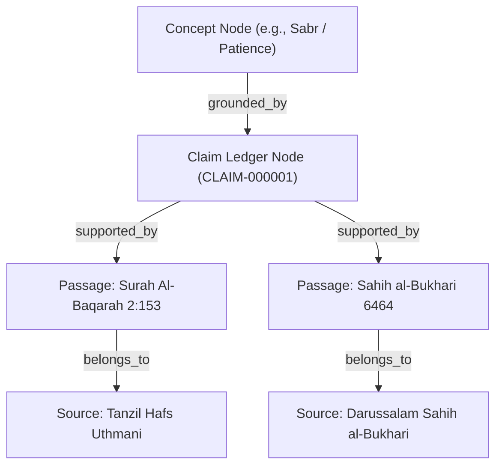

# AMAL OS — EVIDENCE GRAPH ARCHITECTURE

## 1. Overview
The **Evidence Graph** is an interconnected network of canonical Islamic texts, verified translations, concept taxonomies, and cross-source citations. It provides mathematical and graph-theoretic grounding for every spiritual habit, journey, and AI response in AMAL OS.

## 2. Graph Topology & Node Types

### Node Specifications
1. **Source Node (`sources`)**:
   - Stores publisher metadata, licensing terms, checksum (`SHA-256`), edition, and language.
   - Verification status: `PENDING_REVIEW`, `APPROVED`, `REJECTED`, `QUARANTINED`.
2. **Passage Node (`passages`)**:
   - Individual verse, hadith, or legal paragraph.
   - Preserves normalized Arabic text, English translation, structural index (e.g., `surah_number:verse_number` or `hadith_number`), and vector embedding.
3. **Claim Node (`claims`)**:
   - Atomic theological or spiritual proposition (e.g., *"Consistency in worship is beloved to Allah even if small"*).
   - Links to 1 or more canonical supporting passages.
4. **Concept Node (`concepts`)**:
   - Ontological category (e.g., `Salah`, `Dhikr`, `Adab`, `Muamalat`, `Tawbah`).
   - Hierarchical parents and children relations.

## 3. Provenance & Edge Relations
Edges represent typed semantic and jurisprudential relationships:
- `SUPPORTS`: Direct textual evidence supporting a claim.
- `EXPLAINS`: Tafsir or commentary passage elucidating a verse.
- `QUALIFIES`: Hadith detailing or specifying general Quranic injunction (*Takhsis al-'Amm*).
- `CONTRASTS`: Documented divergence between classical schools (*Ikhtilaf*).

## 4. Query Engine
The graph is queried through `services/api/src/modules/knowledge/knowledge.service.ts`:
- Graph traversal depth is bounded (default: max depth 3) to prevent circular reasoning.
- Unverified or quarantined source nodes are strictly pruned before ranking.
