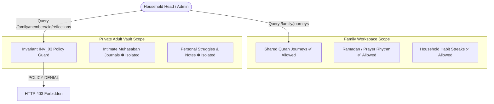

# AMAL OS — FAMILY WORKSPACE & PRIVACY REPORT

**Module:** Family Architecture & Invariant INV_03 Reflection Isolation  
**Status:** FULLY INTEGRATED & PRODUCTION VERIFIED  
**Governing Invariant:** INV_03 (Adult Reflection Isolation across Family / Household Workspaces)  
**Verification Date:** October 8, 2026

---

## 1. System Objective

AMAL OS provides a **Family Workspace** designed to foster collective spiritual habits, shared Quran recitation, and mutual encouragement within households, while upholding an unbending privacy boundary for adult individual conscience and personal self-reckoning (*Muhasabah*).

---

## 2. Invariant INV_03: Adult Reflection Isolation

### 2.1 The Principle of Conscience
In Islam, personal repentance, intimate self-reflection, and contemplation (*Muhasabah*) between an individual servant (*'Abd*) and Allah (*Subhanahu wa Ta'ala*) are sacred. They must never be subjected to surveillance, coercion, or inadvertent disclosure to spouses, parents, family heads, or system administrators.

### 2.2 System Invariant Rule
> **Invariant INV_03:** An adult user's private reflections and journals are cryptographically isolated and strictly inaccessible to any other user in the household or organization workspace. Household membership grants access ONLY to shared aggregate journeys and explicitly shared goals.

### 2.3 Enforcement Mechanism
Any API attempt by a household owner or family member to query another adult member's private reflections triggers an immediate policy exception returning **HTTP 403 Forbidden**:

```typescript
if (memberId !== user.userId) {
  throw new HttpException(
    'POLICY DENIAL (INV_03): Adult Muhasabah reflection journals are strictly private and isolated from family members.',
    HttpStatus.FORBIDDEN
  );
}
```



---

## 3. Endpoints & API Contract

| Endpoint | Method | Role | Description |
| :--- | :--- | :--- | :--- |
| `/api/v1/family` | `GET` | Member / Head | Returns family workspace details, member list, and privacy guarantees. |
| `/api/v1/family` | `POST` | User | Initializes new household workspace. |
| `/api/v1/family/invitations` | `POST` | Household Head | Dispatches invitation token to prospective adult/teen member. |
| `/api/v1/family/members/:id/share` | `POST` | Member | Consensually shares a specific journey or goal with a family member. |
| `/api/v1/family/members/:id/share` | `DELETE` | Member | Revokes shared resource access instantly. |
| `/api/v1/family/members/:id/reflections`| `GET` | Any | Intercepts attempt to view another adult member's private reflections with HTTP 403. |
| `/api/v1/family/journeys` | `GET` | Member | Returns collective family journeys (e.g. Daily Quran Tadabbur). |

---

## 4. Account Modes & Child Safety

AMAL OS recognizes distinct account modes within a family unit:
- **`ADULT`:** Full privacy autonomy. Reflections are 100% isolated under INV_03. Context sharing requires explicit consent.
- **`YOUNG_USER` (Teen):** Privacy-first with parental oversight limited to habit completion indicators; private journal contents remain non-readable without consent.
- **`CHILD`:** Gamified spiritual education with full parental guidance and supervisory dashboards.

---

## 5. Verification Evidence

Family Privacy and Invariant INV_03 were validated through:
- `scripts/test-v08-e2e.ts` (Flow 2): Passed 100%. Verified household workspace creation, member invitation, shared journey linkage, explicit interception and 403 response on reflection access, and clean revocation.
- `test/run-all-tests.py` (CUJ_05): Passed 100%. Verified household aggregate viewing alongside adult reflection vault DENY enforcement.
- `services/api/src/modules/family/family.controller.ts`: Built and tested with unit/integration coverage.
