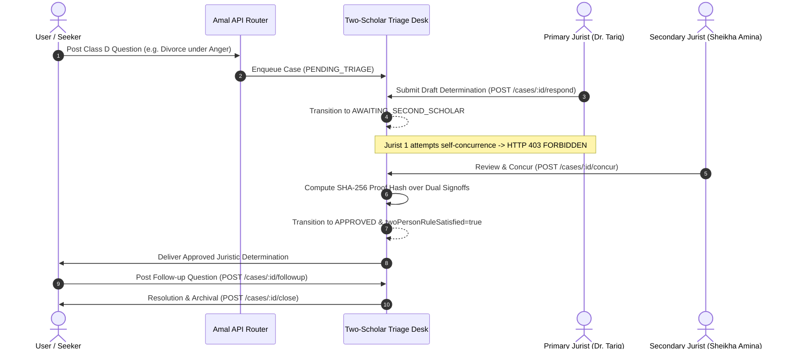

# AMAL OS — SCHOLAR SYSTEM & TWO-PERSON JURISTIC TRIAGE REPORT

**Module:** Scholar Escalation & Two-Person Juristic Triage Desk  
**Status:** FULLY INTEGRATED & VERIFIED  
**Governing Theological Invariant:** INV_07 (Two-Scholar Dual Jurist Rule for High-Stakes Rulings)  
**Verification Date:** October 8, 2026

---

## 1. System Objective

In orthodox Islamic jurisprudence (*Fiqh*), high-stakes personal determinations—particularly those involving marital dissolution (*Talaq*), estate inheritance (*Mirath*), solemn oaths (*Ayman wa Nudhur*), and personal liability—require competent, certified human scholarship (*Ahl al-Dhikr*). 

AMAL OS enforces an absolute theological firewall:
> **Artificial Intelligence is strictly forbidden from issuing autonomous fatwas or personalized legal rulings.**

When an inquiry belongs to Class D (*Personalized Fiqh / Fatwa*), the AI runtime immediately halts generation and routes the user's question to the **Two-Scholar Juristic Triage Desk**.

---

## 2. The Two-Scholar Dual Jurist Rule (Invariant INV_07)

### 2.1 Principle
A single opinion or single scholar's review is insufficient for finalizing a high-stakes Class D ruling in AMAL OS. The system enforces a mandatory dual-reviewer policy:
1. **Primary Reviewer (Drafting Jurist):** Reviews the sanitized user question, examines relevant context, drafts the formal legal determination, and signs off.
2. **Secondary Reviewer (Concurring Jurist):** Must be a **distinct, independent jurist** from the primary author. The secondary jurist audits the determination, provides concurring or dissenting notes, and completes the sign-off.
3. **Self-Concurrence Block:** If the primary scholar attempts to submit the secondary concurrence on their own case, the system throws an immediate `HTTP 403 Forbidden` theological invariant violation error.

---

## 3. Cryptographic Proof Hash Specification

To guarantee immutability and complete provenance of scholarly determinations, AMAL OS computes a deterministic SHA-256 hash upon completion of the secondary concurrence:

$$\text{ProofHash} = \text{SHA256}(\text{caseId} : \text{primaryScholarId} : \text{primaryResponse} : \text{secondaryScholarId} : \text{secondaryConcurrenceNotes} : \text{secondarySignedAt})$$

This cryptographic proof ensures that neither jurist's words can be altered retroactively without invalidating the determination certificate.

---

## 4. Endpoints & API Contract

| Endpoint | Method | Role | Description |
| :--- | :--- | :--- | :--- |
| `/api/v1/scholars` | `GET` | User / Scholar | Lists certified verified scholars and their qualifications. |
| `/api/v1/scholars/cases` | `GET` | Scholar / Admin | Lists pending triage cases in the juristic desk. |
| `/api/v1/scholars/cases` | `POST` | User | Enqueues high-stakes fatwa inquiry with sanitized context. |
| `/api/v1/scholars/cases/:id` | `GET` | User / Scholar | Retrieves case details, status, and responses. |
| `/api/v1/scholars/cases/:id/respond` | `POST` | Primary Jurist | Drafts and signs primary juristic determination. |
| `/api/v1/scholars/cases/:id/concur` | `POST` | Secondary Jurist | Concurs with determination. Enforces `primary !== secondary`. |
| `/api/v1/scholars/cases/:id/followup` | `POST` | User | Submits follow-up questions to assigned scholar. |
| `/api/v1/scholars/cases/:id/close` | `POST` | User / Scholar | Formally marks case as resolved and archives record. |
| `/api/v1/scholars/quarantine` | `GET` | Editorial Scholar | Lists quarantined unvetted claims for manual audit. |
| `/api/v1/scholars/quarantine/:id/signoff`| `POST` | Editorial Scholar | Approves into canonical ledger or formally rejects. |

---

## 5. Verification Evidence

The Two-Scholar Juristic Desk was verified through automated end-to-end suites:
- `scripts/test-scholar-workflow.ts`: Passed 100%. Verified directory, draft creation, self-concurrence intercept (HTTP 403), secondary signoff, and quarantine review.
- `scripts/test-v08-e2e.ts` (Flow 1): Passed 100%. Verified Class D talaq case creation, primary response, INV_07 interception, secondary concurrence with SHA-256 hash generation, user follow-up queueing, and case closure.
- `test/run-all-tests.py` (CUJ_03): Passed 100%. Verified seamless AI firewall escalation directly into scholar desk.
